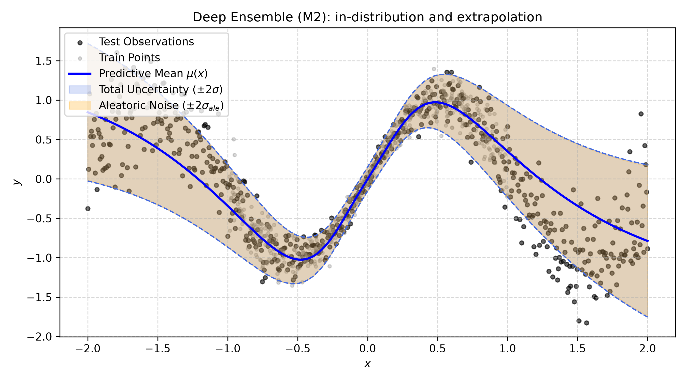
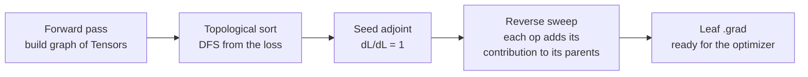
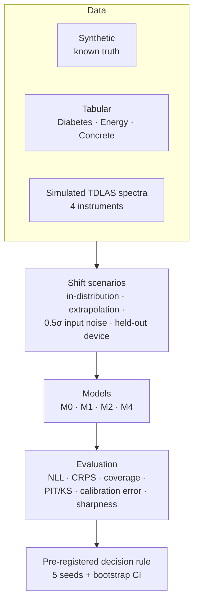
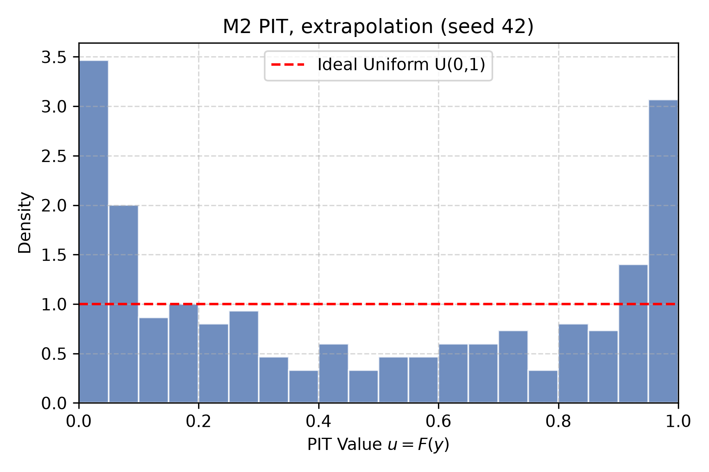
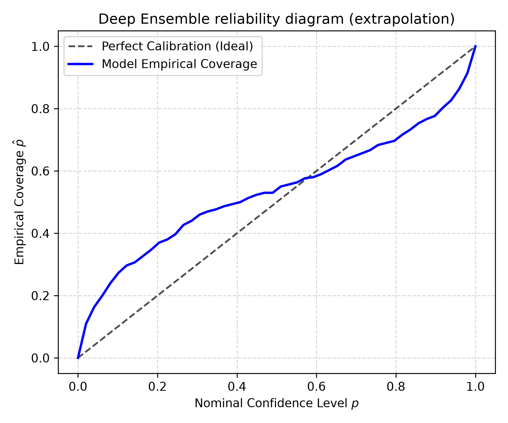
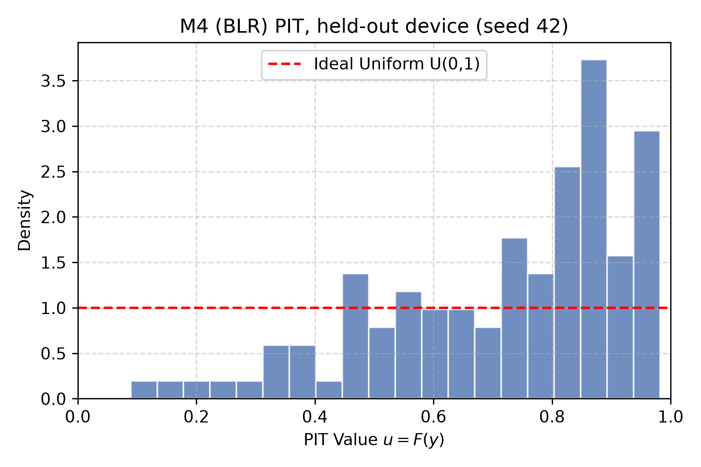
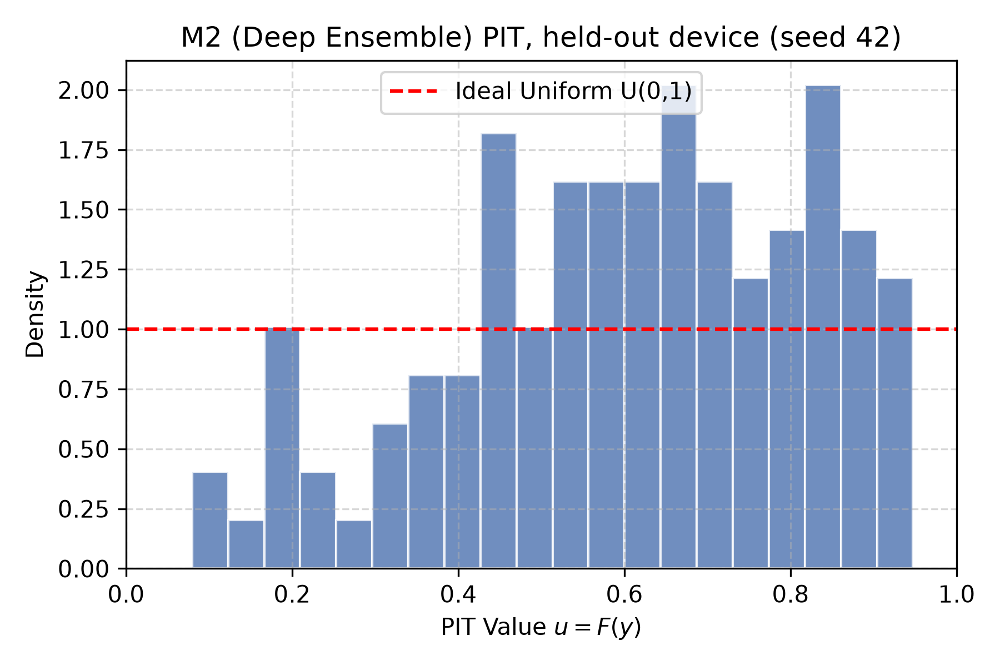
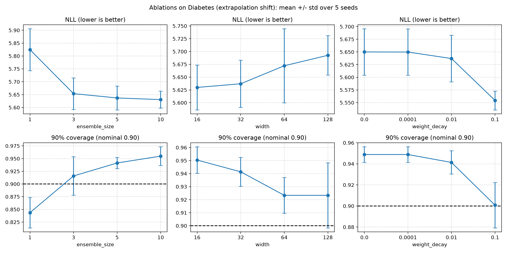

<div align="center">

# UCNet

### Uncertainty-Calibrated Nets, written from scratch in pure NumPy

An autograd engine, a small neural-network library, and an honest empirical study of
**which uncertainty estimates you can trust when the data shifts.**

[](https://github.com/mohammadreza-ui/ucnet/actions/workflows/ci.yml)
[](https://www.python.org/)
[](tests/)
[](src/ucnet)
[](LICENSE)
[](https://github.com/astral-sh/ruff)



<sub>A 5-member deep ensemble trained on x ∈ [−1, 1] and tested on [−2, 2]. The shaded band is ±2σ of the predictive
distribution; outside the training range the bands widen, but, as the study below shows, not by enough.</sub>

</div>

---

## Contents

- [Why this project](#why-this-project)
- [What is inside](#what-is-inside)
- [Quickstart](#quickstart)
- [How it works](#how-it-works)
- [The study: design and method](#the-study-design-and-method)
- [Results](#results)
- [Verification](#verification-how-do-we-know-the-engine-is-correct)
- [Repository layout](#repository-layout)
- [Running everything](#running-everything)
- [Guide to the outputs](#guide-to-the-outputs-figures-and-csvs)
- [Limitations and honest notes](#limitations-and-honest-notes)
- [References](#references) · [License](#license)

---

## Why this project

A regression model that reports "42 ± 3" is only useful if the "± 3" can be believed. Models tend to be
**over-confident when the inputs move away from the training data**, which is exactly when you most need the warning.

UCNet asks one narrow question and answers it with a pre-registered experimental protocol:

> **When data shifts (extrapolation, noisy inputs, a different instrument), which method reports uncertainty that is closest to the truth?**
> A single heteroscedastic network? A deep ensemble? A classical Bayesian linear model?

Two goals run side by side:

1. **Understand the machinery.** Everything (reverse-mode autodiff, layers, optimizers, probabilistic losses, ensembles, calibration metrics) is implemented from first principles in NumPy, with every gradient verified against finite differences and PyTorch.
2. **Do the evaluation properly.** Leak-free preprocessing, hypotheses written down *before* the experiments, five seeds, a fixed decision rule, and negative results reported as such.

> [!NOTE]
> None of the methods here is new (heteroscedastic NLL, deep ensembles, BLR are all established). The contribution is a
> from-scratch, verified implementation and a careful, transparent evaluation of them.

---

## What is inside

| Layer | What it contains |
|---|---|
| **Autograd engine** | `Tensor` with a dynamic computation graph, topological reverse-mode backward, broadcasting-aware gradient accumulation (`unbroadcast`), 20 differentiable ops |
| **Layers** | `Linear` (He/Xavier init), `Conv1D` (sliding windows + `einsum`), `LayerNorm` (analytic backward), ReLU/Tanh/Sigmoid/Softplus/GELU, `Dropout`, `Flatten`, `Sequential` |
| **Optimization** | SGD + momentum, Adam, AdamW (decoupled weight decay), global-norm gradient clipping, cosine schedule, early stopping with best-weight restore |
| **Probabilistic models** | Heteroscedastic Gaussian NLL `(μ(x), ln σ²(x))`, `DeepEnsemble` with aleatoric/epistemic decomposition and exact mixture CDF, closed-form Bayesian linear regression |
| **Calibration metrics** | z-scores, interval coverage, PIT + KS test, regression calibration error, CRPS (closed form), NLL, sharpness, bootstrap CIs, a pre-registered hypothesis-decision rule |
| **Experiments** | Synthetic ground truth, 3 tabular datasets × 3 shift scenarios, a simulated TDLAS spectroscopy benchmark with device-level shift, ablations, a runtime benchmark |

`src/ucnet/` imports **no deep-learning framework**. PyTorch is used only in `tests/` and the runtime benchmark, as a reference.

---

## Quickstart

```bash
git clone https://github.com/mohammadreza-ui/ucnet.git
cd ucnet
python -m venv .venv && source .venv/bin/activate
pip install -e ".[dev]"
```

Train a 5-member deep ensemble on noisy data and ask it about a point **outside** its training range:

```python
import numpy as np
from ucnet.ensemble import DeepEnsemble, ProbabilisticMLP
from ucnet.losses import GaussianNLLLoss
from ucnet.optim import Adam
from ucnet.trainer import fit

rng = np.random.default_rng(0)
X = rng.uniform(-1, 1, size=(600, 1))
y = np.sin(3 * X) + rng.normal(0, 0.05 + 0.2 * np.abs(X))      # noise grows with |x|
X_tr, y_tr, X_val, y_val = X[:480], y[:480], X[480:], y[480:]

members = []
for seed in range(5):                                           # 5 independently initialised networks
    np.random.seed(seed)
    net = ProbabilisticMLP(in_features=1, hidden_dims=(64, 64), activation="tanh")
    fit(net, Adam(net.parameters(), lr=0.01), GaussianNLLLoss(),
        X_tr, y_tr, X_val, y_val, epochs=100, patience=20, seed=seed)
    members.append(net)

pred = DeepEnsemble(members).predict(np.array([[0.0], [0.9], [2.5]]))   # 2.5 is outside the training range
print("mean     :", pred.mean.ravel().round(2))
print("aleatoric:", np.sqrt(pred.aleatoric).ravel().round(2))
print("epistemic:", np.sqrt(pred.epistemic).ravel().round(2))
```

```text
mean     : [-0.    0.46 -0.49]
aleatoric: [0.08 0.28 0.55]
epistemic: [0.01 0.06 0.09]
```

The epistemic term (disagreement between members) is about nine times larger at the unseen point than at `x = 0`.

You can also use the autograd engine directly:

```python
from ucnet import Tensor

x = Tensor([[1.0, 2.0], [3.0, 4.0]], requires_grad=True)
w = Tensor([[0.5], [-1.0]], requires_grad=True)
loss = ((x @ w).tanh() ** 2).mean()
loss.backward()
print(w.grad)      # d loss / d w, same value PyTorch would give
```

---

## How it works

### Autograd in one picture



For a scalar loss `L` and a node `y = f(x)`, the adjoint is `x̄ = (∂y/∂x)ᵀ ȳ`. When a node feeds several consumers their
contributions **add**. Broadcasting is undone by summing over the broadcast axes (`unbroadcast`), which is where most
"right value, wrong shape" bugs come from. Reverse mode costs a small constant times one forward pass regardless of the number of
parameters, which is why it is the right choice for scalar losses.

<details>
<summary><b>Key derivations (click to expand)</b></summary>

**Matrix product.** From `dL = tr(C̄ᵀ dC)` and `dC = dA·B + A·dB`, cycling the trace gives

```
Ā = C̄ Bᵀ        B̄ = Aᵀ C̄
```

**LayerNorm.** With `x̂ = (x − μ)/√(σ²+ε)` and `g = ȳ ⊙ γ`:

```
x̄ = (1/√(σ²+ε)) · ( g − mean(g) − x̂ · mean(g ⊙ x̂) )
```

**Adam bias correction.** With `m₀ = 0`, `E[mₜ] = (1 − β₁ᵗ)·E[g]`, so dividing by `(1 − β₁ᵗ)` removes the bias.

**Heteroscedastic Gaussian NLL** with `s = ln σ²`:

```
ℓ = ½ s + ½ (y − μ)² e^(−s) + ½ ln 2π
```

**Deep ensemble (law of total variance).** For a uniform mixture of `M` Gaussians:

```
σ*² =  (1/M) Σ σ²ₘ        +   (1/M) Σ (μₘ − μ*)²
       └─ aleatoric ─┘        └──── epistemic ────┘
```

**Gaussian CRPS** (closed form): `σ [ z(2Φ(z) − 1) + 2φ(z) − 1/√π ]`, with `z = (y − μ)/σ`.

Full derivations: [docs/math.md](docs/math.md).

</details>

### Two kinds of uncertainty

| | Aleatoric | Epistemic |
|---|---|---|
| Meaning | noise inherent to the data | the model's ignorance |
| Shrinks with more data? | no | yes |
| In this library | each member's predicted `σₘ²(x)` | disagreement `Var(μₘ)` between ensemble members |

### Numerical safety worth knowing

- The network predicts `ln σ²`, not `σ²`: positivity for free, better conditioning.
- `ln σ²` is clamped to `[−10, 5]` **both in the loss and when predicting**. (An early version clamped only in training; out-of-range outputs then produced variances up to `1e37` under shift. That bug is documented in [docs/results.md](docs/results.md#8-corrections-to-the-earlier-version-of-this-report).)
- Stable `sigmoid`, `softplus`, and `logsumexp`; gradient checks run in float64.

---

## The study: design and method



### The models

| ID | Model | Predictive distribution |
|---|---|---|
| **M0** | MLP trained with MSE | Gaussian with one constant σ, estimated from validation residuals |
| **M1** | single heteroscedastic MLP | Gaussian `N(μ(x), σ²(x))` |
| **M2** | deep ensemble, 5 members | uniform mixture of 5 Gaussians (exact mixture CDF for PIT) |
| **M4** | Bayesian linear regression | exact Gaussian posterior predictive, `α, β` tuned on validation |

### The shifts

| Scenario | How it is built |
|---|---|
| **In-distribution** | random 70/15/15 split |
| **Extrapolation** | the 70% lowest values of the most target-correlated feature train the model; the top 30% are the test set |
| **Noise shift** | in-distribution split, then Gaussian noise of 0.5 training-σ is added to the test features |
| **Held-out instrument** | spectra from device 0 are the test set; devices 1–3 train and validate |

### Protocol (what keeps the study honest)

- **No leakage.** Scalers are fitted on training data only; the test set is evaluated once.
- **Equal tuning budget.** `(lr, weight decay)` come from one small grid scored on validation NLL, then are shared by M0, M1, and every M2 member. BLR priors are tuned on validation too.
- **Five seeds** (`42, 123, 456, 789, 1024`), with every initialisation and batch order determined by the seed. Each run writes a manifest (config, seeds, library versions, git commit).
- **Hypotheses were committed before any experiment** ([docs/hypotheses.md](docs/hypotheses.md)). A hypothesis counts as *confirmed* only if the effect has the right sign in **all five seeds** and the 95% bootstrap CI of the mean is strictly on the right side of zero. Otherwise it is reported as *not confirmed*.
- **Calibration is never reported alone.** Coverage always comes with sharpness (mean predictive σ), since a huge σ is calibrated but useless.

| Hypothesis | Statement |
|---|---|
| **H1** | Under shift, M2's 90% coverage is closer to nominal than M1's |
| **H2** | Under shift, M2 has lower NLL than M1 |
| **H3** | Under instrument shift, the classical baseline (M4) loses calibration while M2 keeps coverage |

---

## Results

All numbers are mean ± std over 5 seeds. Full tables, per-seed data and the corrections log are in
[docs/results.md](docs/results.md).

### Hypothesis verdicts

| | Verdict | In one line |
|---|---|---|
| **H1** | ✅ partly: **4 of 6** shifts | Confirmed on Energy and Concrete; not on Diabetes (gain not consistent across seeds) |
| **H2** | ✅ **6 of 6** shifts | The single network is badly over-confident under shift; most of the gap is its outliers (Energy extrapolation NLL **142.6 ± 136.3 → 2.65 ± 0.47**) |
| **H3** | ❌ **not confirmed** | The effect is there in 4 of 5 seeds, but the strict rule fails (see below) |

### What the numbers actually say

> [!IMPORTANT]
> Ensembles fix the single network's over-confidence. They do **not** make uncertainty correct.

- **Synthetic, ground truth known.** In-distribution, the learned noise level matches the true `σ(x)` (RMSE 0.018 for M2) and 90% coverage is ≈ 0.90. Extrapolating, **no model gets close**: coverage is 0.35 (M0), 0.65 (M1), 0.67 (M2), 0.30 (BLR). The ensemble's epistemic σ grows ~6× outside the training range, yet the members extrapolate along similar trends, so agreement is not correctness.
- **Tabular.** M2 beats M1 under shift, but still under-covers on Energy (0.77 extrapolation, 0.65 noise) and Concrete noise shift (0.47) against a nominal 0.90. A linear Bayesian baseline (M4) matches or beats M2 on NLL on all Diabetes scenarios and on Concrete noise shift.
- **Simulated spectroscopy, held-out instrument.** M4 is sharp and accurate in-distribution (95% coverage 0.95), then collapses on the new device (**0.63 ± 0.26**, ranging 0.19 to 0.96 over seeds). M2 keeps coverage ≈ 0.98 **but with intervals about four times wider**. The plain homoscedastic M0 has the best NLL under shift. So the textbook story "ML ensemble robust, classical method brittle" is only half true here.

<table>
<tr>
<td align="center" width="50%"><br><sub><b>PIT, ensemble, extrapolation.</b> U-shape = over-confident.</sub></td>
<td align="center" width="50%"><br><sub><b>Reliability diagram.</b> Curve below the diagonal at high levels = intervals too narrow.</sub></td>
</tr>
<tr>
<td align="center"><br><sub><b>Classical baseline (M4), new instrument.</b> Mass piles up near 1: biased and over-confident.</sub></td>
<td align="center"><br><sub><b>Deep ensemble (M2), new instrument.</b> Mass in the middle, no tails: over-dispersed, wide intervals.</sub></td>
</tr>
</table>

### Ablations (Diabetes, extrapolation shift)

<div align="center">

</div>

- More members help (NLL 5.825 → 5.631 from M=1 to M=10) with diminishing returns after M=3; coverage rises monotonically and **overshoots** 0.90 at M=10 (0.955).
- Wider networks do not help. Stronger weight decay (0.1) gives the best test NLL, but selection stays on validation.

### Runtime (CPU, float64, 1 thread)

| Operation | UCNet | PyTorch | UCNet / PyTorch |
|---|---|---|---|
| 2-layer tanh MLP 128-128-128, fwd + bwd | 0.267 ms | 0.316 ms | 0.84× |
| Adam step, 10 000 parameters | 0.058 ms | 0.061 ms | 0.94× |
| Conv1D (8→16 ch, L=200, K=7), fwd + bwd | 9.74 ms | 1.11 ms | 8.82× |

Micro-benchmarks on small shapes mostly measure framework overhead; they are not a claim that NumPy beats PyTorch.

---

## Verification: how do we know the engine is correct?

51 tests, all runnable with `pytest`:

| Check | What it proves |
|---|---|
| **Finite-difference gradient checks** (float64, relative error < 1e-6) | every op and layer's analytic backward, including broadcasting and several shapes |
| **PyTorch parity** (float64, `rtol = 1e-7`) | forward values and gradients of `Linear`, `Conv1D` (several kernel/stride/padding combos), `LayerNorm`, activations, softmax-CE, Gaussian NLL, a deep `Sequential` MLP |
| **Optimizer trajectories** | SGD / Adam / AdamW match `torch.optim` over 100 steps; a small MLP trained identically ends with identical weights |
| **Metric validation** | coverage, PIT uniformity and z-scores on data drawn from the predicted distribution; halving σ must break them; CRPS formula against numerical integration |
| **Ensemble / BLR** | law-of-total-variance arithmetic on hand-computed cases; BLR epistemic growth under extrapolation |
| **Regression tests** | one test per bug found in code review (stale adjoints on repeated `backward`, clamp consistency, mixture-CDF shapes, best-checkpoint restore, silent data fallback, …) |

---

## Repository layout

```text
ucnet/
├── src/ucnet/
│   ├── tensor.py        # Tensor, computation graph, backward, unbroadcast
│   ├── ops.py           # differentiable operations and their adjoints
│   ├── nn/              # Module, Linear, Conv1D, LayerNorm, activations, Sequential
│   ├── losses.py        # MSE, softmax cross-entropy, heteroscedastic Gaussian NLL
│   ├── optim.py         # SGD, Adam, AdamW, clipping, cosine schedule
│   ├── trainer.py       # fit(): mini-batches, validation, early stopping
│   ├── ensemble.py      # ProbabilisticMLP, DeepEnsemble, mixture CDF
│   ├── baselines.py     # Bayesian linear regression, homoscedastic baseline
│   ├── metrics.py       # coverage, PIT/KS, CRPS, NLL, bootstrap, hypothesis rule
│   ├── data.py          # leak-free scaling, shift builders, dataset loaders
│   ├── viz.py           # PIT histograms, reliability diagrams, uncertainty bands
│   └── runlog.py        # run manifests (config, seeds, versions, git commit)
├── experiments/         # run_synthetic · run_uci · run_spectral · run_ablations · run_benchmark
├── tests/               # gradcheck, PyTorch parity, optimizers, metrics, ensemble, regressions
├── docs/
│   ├── math.md          # derivations
│   ├── hypotheses.md    # pre-registered hypotheses and decision rule
│   ├── results.md       # full results, per-scenario tables, corrections log
│   └── figures/         # figures shown in this README
└── MODEL_CARD.md        # data, metrics, intended use, limitations
```

---

## Running everything

### 1. Install

```bash
python -m venv .venv && source .venv/bin/activate
pip install -e ".[dev]"
```

Python 3.11 or 3.12. The first tabular run downloads the Energy and Concrete tables from the UCI repository (network access
needed) and caches them in `data/cache/`. If a dataset cannot be read, the script **stops with an error**; it never substitutes simulated data.

### 2. Test

```bash
pytest -q
ruff check .
```

### 3. Reproduce the experiments

Each script prints a summary table, writes CSVs and figures under `results/`, and records a manifest next to them.
Typical run time is a few minutes per script on a laptop CPU.

```bash
python experiments/run_synthetic.py          # Experiment A: synthetic ground truth, 5 seeds
python experiments/run_uci.py                # Experiment B: Diabetes, Energy, Concrete × 3 shifts × 5 seeds
python experiments/run_uci.py diabetes       #   (or a single dataset)
python experiments/run_spectral.py           # Experiment C: simulated spectra, held-out instrument
python experiments/run_ablations.py          # ensemble size, width, weight decay
python experiments/run_benchmark.py          # runtime vs PyTorch
```

To keep a log of a run:

```bash
mkdir -p results/logs && python -u experiments/run_uci.py | tee results/logs/tabular.log
```

`results/` is git-ignored, so regenerate it locally. The figures in this README are copied to `docs/figures/`.

### 4. Use it as a library

```python
from ucnet import Tensor
import ucnet.nn as nn
from ucnet.optim import Adam, AdamW
from ucnet.losses import MSELoss, GaussianNLLLoss, SoftmaxCrossEntropyLoss
from ucnet.metrics import evaluate_calibration
```

`evaluate_calibration(y, mu, std, cdf_fn=...)` returns a report with NLL, CRPS, sharpness, coverage at 50/80/90/95%,
z-score moments, KS statistic and calibration error. Pass the model's exact CDF as `cdf_fn` to get PIT from the true
predictive distribution (for an ensemble, the mixture).

---

## Guide to the outputs (figures and CSVs)

Every experiment leaves the same kinds of artefacts, so once you can read one you can read them all.

### Reading the figures

| Figure | Healthy | What a problem looks like |
|---|---|---|
| **PIT histogram** (`u = F(y)`) | flat at density 1 | **U-shape:** over-confident (intervals too narrow). **Hump in the middle:** under-confident (too wide). **Skewed to one side:** biased predictions |
| **Reliability diagram** | curve on the diagonal | below the diagonal at high levels: too narrow; above it: too wide |
| **Uncertainty band plot** | most points inside the ±2σ band, band hugging the data in-distribution | points outside the band beyond the training range; a band as wide as the data itself (calibrated but useless) |
| **Ablation plots** | error bars overlapping the trend | a "best" point that overshoots the 0.90 target is over-covering, not better |

### Reading the numbers

| Metric | Lower/higher is better | Read it as |
|---|---|---|
| **NLL** | lower | log-score; punishes confident mistakes very hard |
| **CRPS** | lower | like absolute error, but for a whole distribution |
| **Coverage (50/80/90/95%)** | closest to nominal | fraction of targets inside the central interval |
| **Sharpness** | lower, *given* good coverage | mean predictive σ; always read together with coverage |
| **CalErr** | lower | mean squared gap between nominal and empirical levels (0 = perfect) |
| **z mean / z var** | 0 / 1 | mean and variance of standardised residuals |
| **KS p-value** | high | PIT uniformity test (small = miscalibrated) |

### Where things land

| Path | Contents |
|---|---|
| `results/<experiment>/*_summary.csv` | mean ± std over seeds, one row per scenario/model |
| `results/<experiment>/*_per_seed.csv` | every seed's raw metrics (use this for your own statistics) |
| `results/tabular/tabular_summary.csv` | also holds the H1/H2 advantages, CIs, and *confirmed* flags |
| `results/spectral/spectral_h3.csv` | the three components of the H3 verdict |
| `results/<experiment>/*_manifest.json` | seeds, config, library versions, git commit and dirty flag |
| `results/logs/*.log` | console output of each run |

> There is no web dashboard in this repository; the CSVs and PNGs above are the output. If you want an interactive
> view, `*_per_seed.csv` loads directly into pandas, a notebook, or any BI tool.

---

## Limitations and honest notes

- Five seeds; a bootstrap over five per-seed numbers is a coarse summary.
- NLL, CRPS, coverage and sharpness for ensembles use the moment-matched Gaussian `(μ*, σ*²)`; only PIT/KS/CalErr use the exact mixture CDF.
- The spectral data are **simulated** (Beer–Lambert, Lorentzian line) with a single shift type, small MLPs as neural baselines, and Bayesian linear regression instead of a Levenberg–Marquardt/Cramér–Rao reference.
- Hyper-parameters were tuned once per dataset on one in-distribution validation split and reused for the shifted scenarios.
- `Conv1D` and `LayerNorm` are verified by tests but not used in the reported experiments.
- An earlier version of this project reported all three hypotheses as confirmed. A code review found defects (including a silent synthetic-data fallback and a calibration-metric shape bug) and a post-hoc redefinition of H3; everything was fixed and rerun. The full list is in [docs/results.md §8](docs/results.md#8-corrections-to-the-earlier-version-of-this-report).

See [MODEL_CARD.md](MODEL_CARD.md) for intended use and out-of-scope uses.

---

## References

- Rumelhart, Hinton & Williams (1986). *Learning representations by back-propagating errors.*
- Baydin et al. (2018). *Automatic differentiation in machine learning: a survey.*
- Kingma & Ba (2015). *Adam.* · Loshchilov & Hutter (2019). *Decoupled weight decay regularization.*
- Ba, Kiros & Hinton (2016). *Layer normalization.* · He et al. (2015). *Delving deep into rectifiers.*
- Nix & Weigend (1994). *Estimating the mean and variance of the target probability distribution.*
- Lakshminarayanan, Pritzel & Blundell (2017). *Simple and scalable predictive uncertainty estimation using deep ensembles.*
- Kendall & Gal (2017). *What uncertainties do we need in Bayesian deep learning for computer vision?*
- Kuleshov, Fenner & Ermon (2018). *Accurate uncertainties for deep learning using calibrated regression.*
- Gneiting & Raftery (2007). *Strictly proper scoring rules, prediction, and estimation.*
- Ovadia et al. (2019). *Can you trust your model's uncertainty? Evaluating predictive uncertainty under dataset shift.*
- Bishop (2006). *Pattern Recognition and Machine Learning*, ch. 3.

## License

[MIT](LICENSE) © 2026 Mohammadreza Salehi
